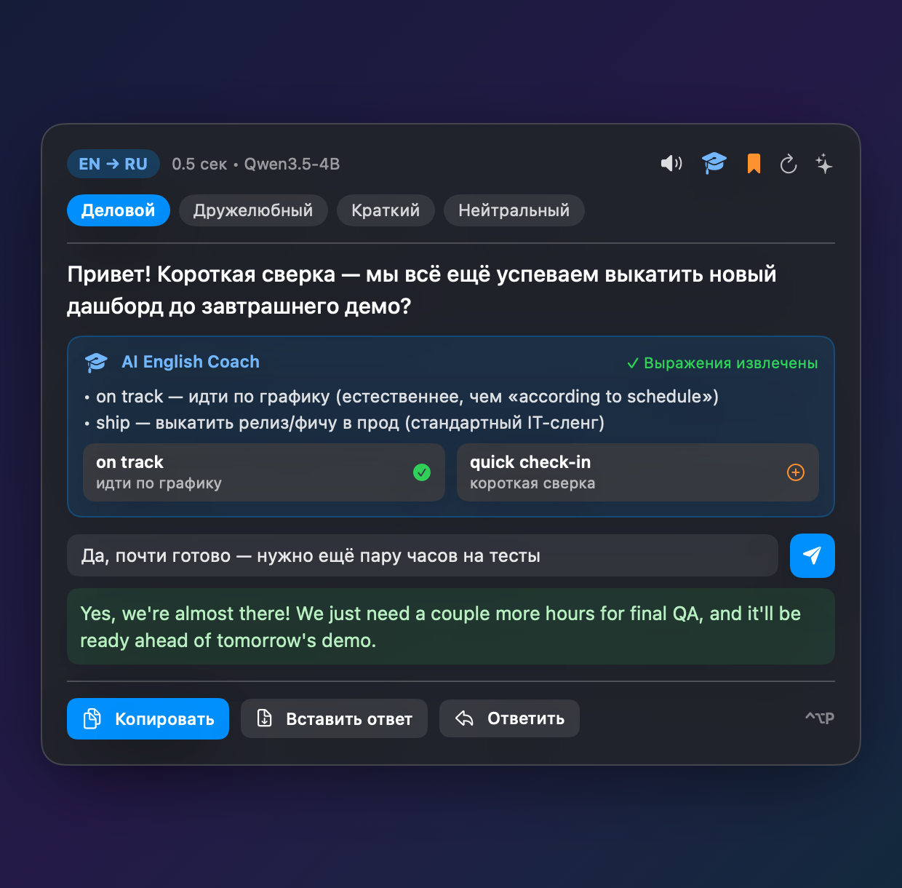
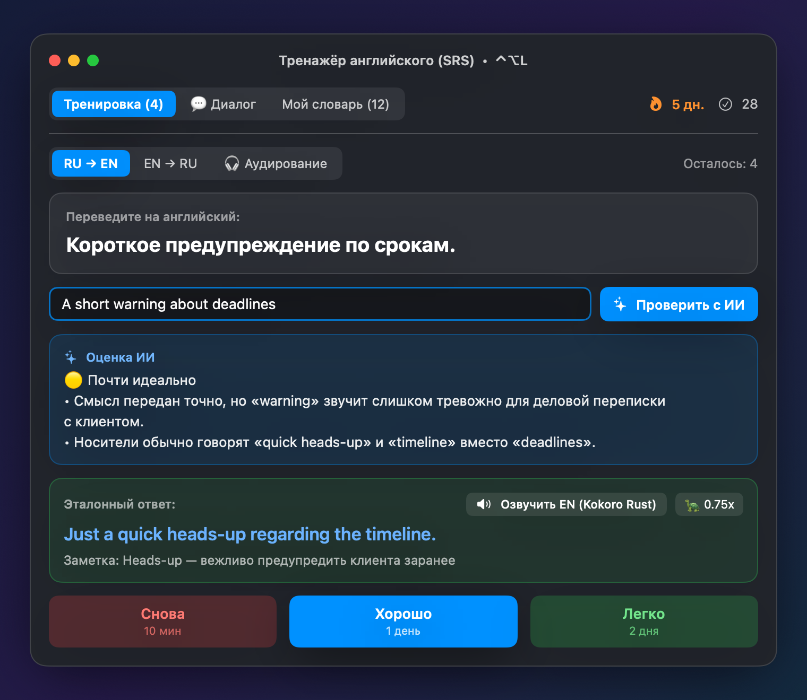
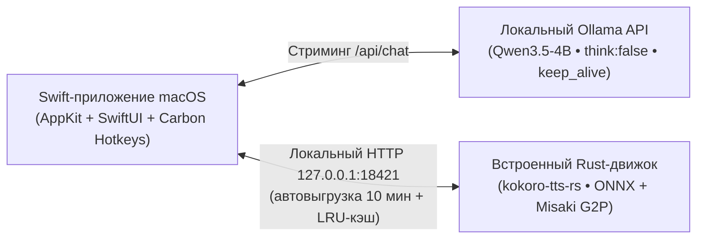

# Ollama Translator (RU ↔ EN) для macOS

[English](README.md) | **Русский**

Нативное мини-приложение в строке меню macOS для быстрого локального перевода общения с клиентами (**RU ↔ EN**) через [Ollama](https://ollama.com) — работает в Telegram, Slack, WhatsApp, почте, браузере и любых других приложениях.

Полностью локально и приватно, без платных API. По умолчанию настроено на модель `hf.co/mradermacher/Qwen3.5-4B-SOMPOA-heresy-v2-GGUF:Q4_K_M` (работает с любой моделью Ollama).

<p align="center">
  
  &nbsp;
  
</p>

## Скачать готовую сборку

Скачайте готовое приложение для Apple Silicon в **[GitHub Releases](https://github.com/YNDmitry/ollama-translator/releases/latest)**:

1. Скачайте и распакуйте `OllamaTranslator-v2.5.0-arm64.zip`.
2. Перенесите `OllamaTranslator.app` в папку `/Applications/`.
3. Если macOS предупредит о неподписанном разработчике, снимите карантин:
   ```bash
   xattr -dr com.apple.quarantine /Applications/OllamaTranslator.app
   ```
4. Запустите приложение и выдайте разрешение **Системные настройки → Конфиденциальность и безопасность → Универсальный доступ (Accessibility)**.
5. *(Опционально)* В **Настройки → Основные → Озвучка произношения (TTS)** нажмите **«Скачать модель (~338 МБ)»** для живого офлайн-голоса **Kokoro-82M** — без терминала и без Python!

## Горячие клавиши (работают в любой раскладке RU / EN)

| Комбинация | Действие |
|---|---|
| **`⌃⌥T`** | **Перевести и заменить на месте** (если ничего не выделено — автоматически выбирает всё поле ввода `⌘A`) |
| **`⌃⌥P`** | **Всплывающее окно с переводом** — стриминг в реальном времени, смена стиля, другой вариант (`↻`), улучшение английского (`✨`), быстрый словарь и ответ клиенту |
| **`⌃⌥E`** | **Улучшить мой английский (`EN ✨ EN`)** — исправляет ошибки и делает фразу естественной прямо на месте |
| **`⌃⌥G`** | **Окно быстрого переводчика** (`⌘↩` — перевести, `⌘⇧C` — скопировать) |
| **`⌃⌥L`** | **Тренажёр английского (Карточки SRS)** — интервальное повторение сохранённых фраз, озвучка и проверка перевода с ИИ |
| **`Esc`** | Отменить идущий перевод или закрыть всплывающее окно |

Все сочетания клавиш можно переназначить в **Настройки → Горячие клавиши**.

## Возможности

- **Замена текста на месте с сохранением буфера обмена** — заменяет выделенный текст прямо в чате и восстанавливает твой прежний буфер обмена.
- **Автовыбор поля ввода без выделения** — напечатал сообщение в Telegram/Slack/WhatsApp, нажал `⌃⌥T` (или `⌃⌥E`) без выделения, и оно сразу заменилось переводом (с защитой от случайного выбора слишком длинных страниц).
- **Стриминг в реальном времени** — во всплывающем окне (`⌃⌥P`) и быстром переводчике (`⌃⌥G`) слова появляются сразу через ~0.2 сек.
- **Ответ клиенту с учётом контекста прямо из всплывашки** — выделил сообщение клиента → нажал `⌃⌥P` → прочитал перевод → нажал **«Ответить»**, написал по-русски и нажал `Enter` → получил естественный EN-ответ с учётом письма клиента → кнопка **«Вставить в чат»** или **«Копировать ответ»**.
- **Активное изучение английского прямо в работе**:
  - **AI-разбор фразы (`🎓`) + Авто-выжимка выражений** — разбирает лексику/грамматику и в 1 клик вытаскивает 2–3 коротких полезных идиомы/фразовых глагола из длинного письма прямо в карточки.
  - **Живая локальная озвучка (`🔊`) на нативном Rust (`kokoro-tts-rs`)** — встроенный бинарник на Rust + ONNX Runtime + Misaki G2P прямо внутри `.app` (**без Python, без `uv`, без `espeak-ng`**). 6 живых US/UK голосов Kokoro-82M, LRU-кэш аудио, автовыгрузка через 10 мин простоя (0 МБ RAM), защита от зависших процессов и резерв на системный голос macOS. Для скачивания весов модели один раз запусти `./scripts/setup_kokoro_tts.sh`.
  - **Тренажёр карточек, Аудирования и 🗣️ Говорения (`⌃⌥L`)** — режимы `RU → EN`, `EN → RU`, **🎧 Аудирование** (текст скрыт + `🐢 0.75x`) и **🗣️ Говорение (Shadowing)**: произноси фразу вслух → локальный `whisper.cpp` на Metal GPU показывает пословный diff произношения (зелёные/пропущенные/искажённые слова + % точности) и AI-советы по дикции!
  - **Симулятор переписки и голоса с клиентом (`💬`)** — 5 реальных сценариев с ответами текстом или **голосом 🎙️**, озвучкой клиента через Kokoro и мягкой правкой твоего английского.
- **Бережное отношение к RAM**: 0% CPU в простое, автовыгрузка Ollama и Kokoro + кнопка **«Выгрузить модели (освободить RAM)»** в меню-баре.
- **Улучшение английского (`EN ✨ EN`) + «Другой вариант» (`↻`)** — можно полировать свой английский или в 1 клик получить альтернативную формулировку.
- **Словарь замен (глоссарий)** — добавление слов прямо из всплывающего окна (иконка книги) или в Настройках. Два режима: *Подсказка ИИ* и *Точная замена* (с сохранением регистра и границ слов).
- **Стили общения** — `Деловой`, `Дружелюбный`, `Краткий`, `Нейтральный`.
- **История переводов** — последние 50 переводов с поиском в Настройках и быстрым копированием последних 10 прямо из меню-бара.
- **Оптимизация под Qwen3.5** — автоматически отключает режим рассуждений (`think: false`), вырезает теги `<think>` и удерживает модель в памяти (`keep_alive: 30m`).
- **Статус Ollama в меню-баре** — показывает подключение и умеет запускать Ollama в 1 клик.

## Гибридная архитектура



## Сборка из исходников

Требуется macOS 13+ и Xcode Command Line Tools (`swiftc`). Внешних зависимостей нет.

```bash
git clone https://github.com/YNDmitry/ollama-translator.git
cd ollama-translator
./scripts/build_app.sh
cp -R dist/OllamaTranslator.app /Applications/
open /Applications/OllamaTranslator.app
```

Убедитесь, что Ollama запущена и модель скачана:

```bash
ollama run hf.co/mradermacher/Qwen3.5-4B-SOMPOA-heresy-v2-GGUF:Q4_K_M
```

## Конфигурация и история

- Настройки и словарь: `~/Library/Application Support/OllamaTranslator/config.json`
- История переводов: `~/Library/Application Support/OllamaTranslator/history.json`

## Лицензия

[MIT](LICENSE)
